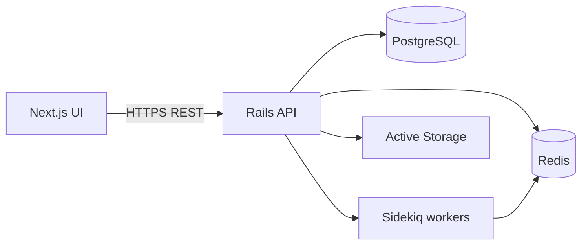

# Architecture

## Overview

Modular monolith: one Rails API application owns all business rules and PostgreSQL data. Next.js is a B2B admin UI that calls versioned REST endpoints under `/api/v1`.

## Backend layers

| Layer | Responsibility |
|-------|----------------|
| `controllers/api/v1` | Auth, authorization, params, HTTP status |
| `services/*` | Commands and transactions |
| `queries/*` | Complex reads, reports, matrix |
| `serializers/api/v1` | Stable JSON contracts |
| `policies` | Role-based authorization |
| `jobs` | Async import, PDF, notifications |

Controllers stay thin. Financial math runs only in services using `BigDecimal` / `NUMERIC`.

## Standard result object

Services return `ApplicationService::Result`:

- `success?` / `failure?`
- `data` — payload on success
- `errors` — structured messages on failure

## Frontend layers

- **App Router** route groups: `(auth)`, `(dashboard)`
- **services/api** — axios/fetch wrapper, credentials included
- **TanStack Query** — server state per domain module
- **React Hook Form + Zod** — forms (Phase 1+)
- **shadcn/ui** — shared primitives

## Authentication (Phase 0)

- Email + password with `has_secure_password`
- Server-side session in encrypted cookie (`_wholesale_session`)
- Login sets session; logout clears it
- `Current.user` from session for API requests
- CORS configured for `http://localhost:3001` with `credentials: true`
- Production: shared parent domain or reverse proxy for same-site cookies

## Cross-cutting concerns

- **Audit**: `audit_logs` table (Phase 5+)
- **Idempotency**: DB locks for invoice/challan numbering (Phase 3+)
- **Files**: Active Storage for order attachments
- **Docs**: OpenAPI via rswag (incremental)

## Deployment topology (target)

Docker Compose services: `postgres`, `redis`, `backend`, `sidekiq`, `frontend`. Kamal optional for production.
